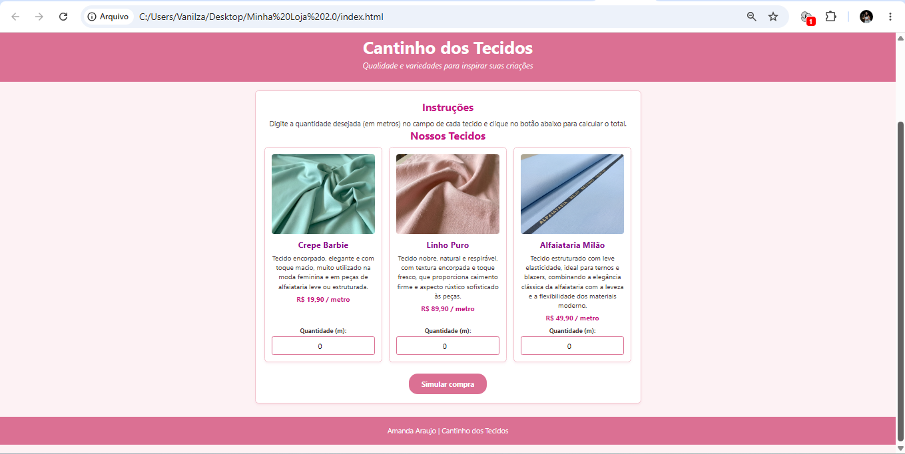

# Desafio 1 — Cantinho dos Tecidos: Simulador de Compras

**Nome do Aluno:** Amanda Araujo
**Trilha:** Desenvolvimento Web  

## Link de Acesso a Loja
**Acesse a loja online em:**
https://amandaitz89-dev.github.io/Cantinho-dos-Tecidos./

## Apresentação da Loja
**Cantinho dos Tecidos** — *Qualidade e variedades para inspirar suas criações.*  
Loja virtual fictícia de tecidos selecionados comercializados por metro para ateliês e alta costura.

### Produtos e Preços:
* **Crepe Barbie:** R$ 19,90 / metro
* **Linho Puro:** R$ 89,90 / metro
* **Alfaiataria Milão:** R$ 49,90 / metro

## Tecnologias e Instruções de Execução
* **Tecnologias:** HTML5, CSS3 e JavaScript.
* **Execução:** Abra o arquivo `index.html` em qualquer navegador web, selecione as quantidades desejadas em cada card de produto e clique no botão "Simular compra".

## Captura de Tela
*(Adicione a imagem na pasta assets/ e substitua o caminho abaixo)*  

## Testes Realizados
1. Deixar todos os campos em `0`: exibiu a mensagem "Nenhum produto foi selecionado".
2. Selecionar 2m de Linho Puro (R$ 179,80): calculou o subtotal e aplicou o desconto de 10% (-R$ 17,98), resultando em R$ 161,82.
3. Selecionar 2m de Crepe Barbie (R$ 39,80): calculou o valor correto sem desconto por ser inferior a R$ 150,00.

## Dificuldades Encontradas e Aprendizados
Substituir o uso de `prompt()` por seletores `<input type="number">` integrados aos cards de cada produto no HTML e resgatar seus valores via JavaScript com `document.getElementById().value`.

## Uso de Inteligência Artificial
A IA auxiliou no desenvolvimento da estrutura em HTML/CSS/JS e na implementação dos campos de quantidade em cada cartão de produto.
